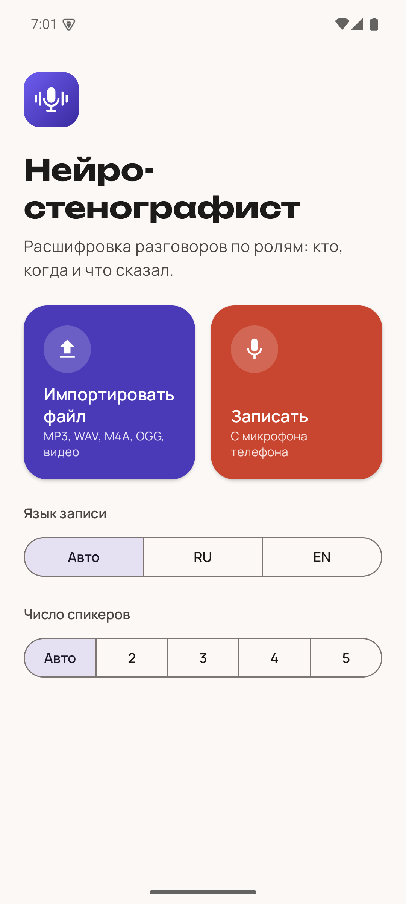
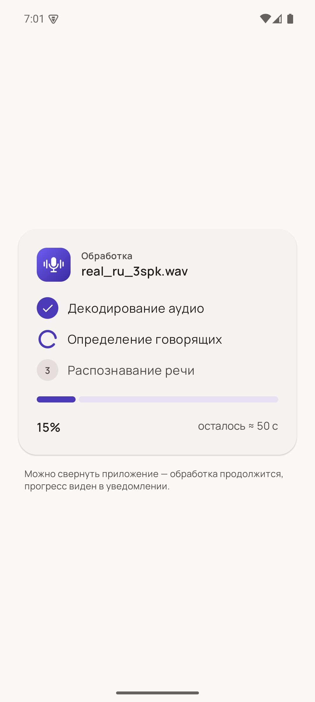
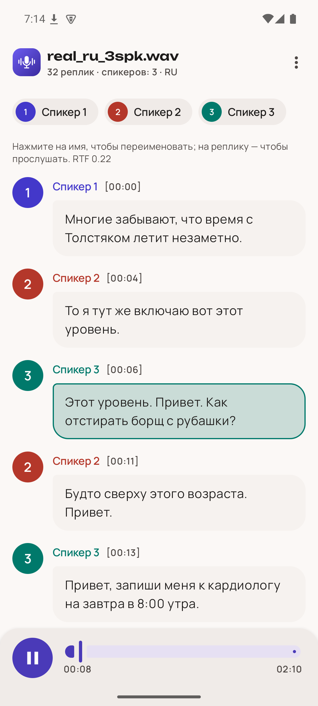
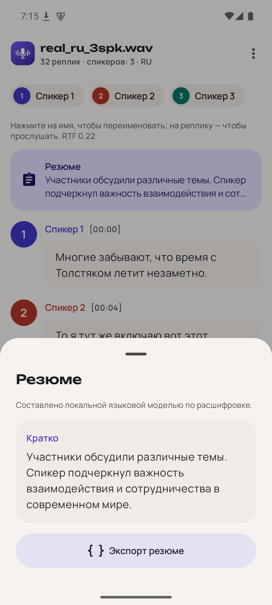
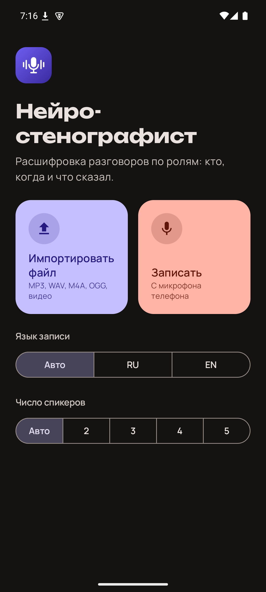
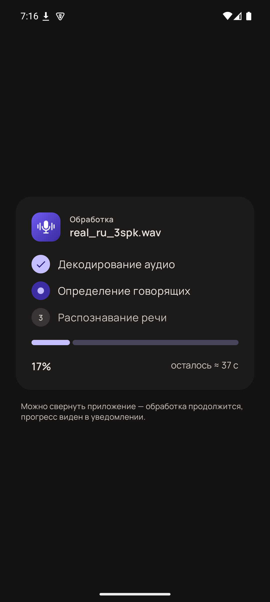
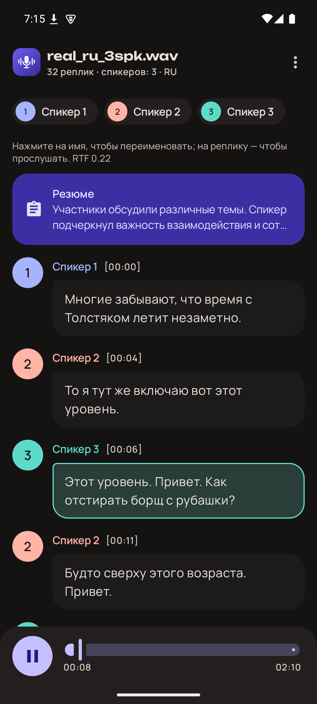
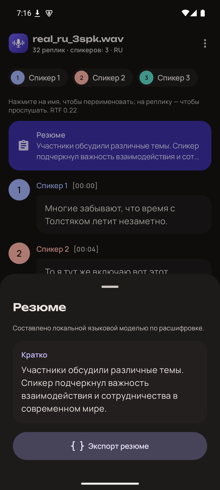

# Нейро-стенографист

Android-приложение, которое превращает запись разговора
в расшифровку: распознаёт речь (русский и английский, язык определяется автоматически), разделяет
говорящих, ставит таймкоды каждой реплике и экспортирует результат в JSON. Локальная LLM
(Qwen2.5-0.5B через llama.cpp) по кнопке делает краткое резюме встречи.

**Скачать APK:** [neuro-steno-v1.0.apk](https://github.com/zzzatoox/neuro-steno/releases/download/v1.0/neuro-steno-v1.0.apk)
(GitHub Releases, ~964 МБ, arm64-v8a, Android 8.0+) · Лендинг: <https://zzzatoox.github.io/neuro-steno/landing/>

| Главный экран | Обработка | Расшифровка | Резюме (LLM) |
|---|---|---|---|
|  |  |  |  |
|  |  |  |  |

## Возможности
- **Распознавание речи:** русский (GigaAM v3 с пунктуацией и заглавными буквами) и английский (Whisper base.en),
  язык определяется автоматически или выбирается вручную.
- **Диаризация:** автоматически 2–6 участников или заданное число спикеров; спикеров можно переименовать.
- **Таймкоды** начала и конца каждой реплики; тап по реплике проигрывает запись с этого места.
- **Вход:** импорт любого аудио/видео, которое декодирует Android, или запись с микрофона.
- **Экспорт:** JSON строго по формату задачи, TXT; резюме локальной LLM — отдельным файлом.
- **Работа без сети:** все модели встроены в APK и выполняются на процессоре телефона, записи никуда
  не отправляются, приложение не запрашивает разрешение на доступ в интернет.
- Светлая и тёмная тема по системным настройкам, themed icon на Android 13+.

## Быстрый старт
1. **Установка.** Скачайте APK и установите (разрешите установку из неизвестных источников) или
   `adb install neuro-steno-v1.0.apk`. При первом запуске модели грузятся в фоне ~5 с.
2. **Импорт.** Карточка «Импортировать файл» → выберите файл (WAV, MP3, M4A/AAC, OGG/Opus, FLAC, AMR, видео с
   аудиодорожкой — всё, что декодирует Android). Или «Записать» — запись с микрофона.
3. **Запуск.** Расшифровка стартует сразу после выбора файла. Язык: «Авто» (по умолчанию) / «RU» /
   «EN»; число спикеров: «Авто» или 2–5. Обработка идёт в foreground-сервисе — приложение можно
   свернуть, экран можно заблокировать.
4. **Результат.** Реплики в виде чата: аватар и цвет спикера, время `[мм:сс]`; тап по реплике —
   воспроизведение с этого места (плеер внизу экрана), тап по имени — переименование (только в UI/TXT).
5. **Экспорт.** Меню «⋮» → «Экспорт JSON» → сохранить `<имя_аудио>.json` через системный диалог (например, в Downloads).
   Также «Экспорт TXT» и «Резюме (LLM)» → «Экспорт резюме» (`<имя>.summary.json`, отдельный файл).

Формат JSON (строго по ТЗ):
```json
{ "transcript": [ { "speaker_id": "speaker_1", "start_ms": 1250, "end_ms": 4380, "text": "Добрый день!" } ] }
```

## Ключевые метрики
Эмулятор Android arm64 (Apple Silicon, 4 ГБ RAM), release-сборка, режимы «Авто» (язык и спикеры),
9 тестовых записей; подробно — [docs/TEST_RESULTS.md](docs/TEST_RESULTS.md).

| Набор | WER (с пункт.) | WER без пункт. | DER | Ошибка таймкодов | RTF |
|---|---|---|---|---|---|
| RU, 6 записей (4 синтетика + 2 живые голоса) | 0.198 | **0.045** | **0.087** | 31–741 мс | **0.086** |
| EN, 2 звонка (синтетика) | 0.164 | 0.079 | 0.034 | 32–52 мс | 0.140 |
| EN, AMI (дальний микрофон, 4 спикера, стресс-тест) | 0.753 | 0.674 | 0.312 | — | 0.124 |

- RTF 0.086 — 1 минута записи обрабатывается за ~5 с (диаризация + ASR, без резюме).
- Автоопределение языка верно на 9/9 записях; длинные записи 10 и 30 минут — без падений, пик памяти 940 МБ.

## Модели (все внутри APK)
| Задача | Модель | Размер |
|---|---|---|
| ASR RU (с пунктуацией и регистром) | GigaAM v3 transducer-punct, int8 | 232 МБ |
| ASR EN | Whisper base.en, int8 | 160 МБ |
| Определение языка | Whisper tiny (multilingual), int8 | 103 МБ (60 МБ сжато в APK) |
| Сегментация спикеров | pyannote segmentation-3.0, int8 | 1.5 МБ |
| Эмбеддинги спикеров | NeMo TitaNet-small | 40 МБ |
| VAD | Silero VAD | 0.6 МБ |
| LLM (резюме) | Qwen2.5-0.5B-Instruct, GGUF Q4_0 | 429 МБ |

Движки: [sherpa-onnx](https://github.com/k2-fsa/sherpa-onnx) 2.0.1 (ASR, VAD, диаризация, LID),
[llama.cpp](https://github.com/ggml-org/llama.cpp) b12183 (LLM, свой JNI). Лицензии — в [docs/ARCHITECTURE.md](docs/ARCHITECTURE.md).

## Документация
- Сборка с нуля и запуск eval: [src/README.md](src/README.md)
- Архитектура и решения: [docs/ARCHITECTURE.md](docs/ARCHITECTURE.md)
- Ограничения: [docs/LIMITATIONS.md](docs/LIMITATIONS.md)
- Методика и результаты тестов: [docs/TEST_RESULTS.md](docs/TEST_RESULTS.md), [artifacts/test-results/results.csv](artifacts/test-results/results.csv)
- Демо: [artifacts/demo/README.md](artifacts/demo/README.md)
- Журнал решений: [NOTES.md](NOTES.md), план: [PLAN.md](PLAN.md)

Модели и APK в git не хранятся: `scripts/download_models.sh` скачивает модели, APK — в GitHub Releases.
