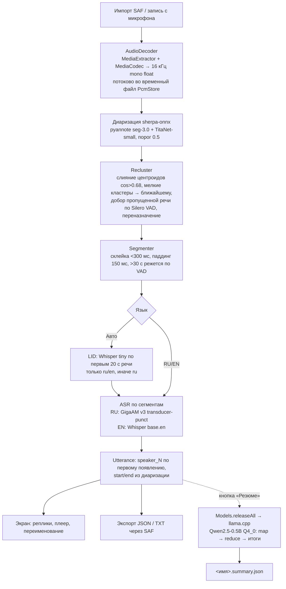

# Архитектура решения

## Контекст
Офлайн-расшифровка диалогов на Android: аудиофайл или запись с микрофона → текст с пунктуацией →
говорящие → реплики с таймкодами → JSON. Сети нет: все модели лежат в APK (assets), разрешение
INTERNET не запрашивается. Целевое устройство — arm64-v8a, ~4 ГБ RAM.

## Пайплайн

Вся тяжёлая работа выполняется в `ProcessingService` (foreground service, тип dataSync, partial wake lock,
однопоточная очередь). Время этапов и RTF пишутся в logcat (тег `STENO`).

## Модули (`src/mobile/android/app/src/main/java/com/nuclearhack/steno/`)
| Файл | Роль |
|---|---|
| `MainActivity.kt`, `MainViewModel.kt`, `AppState.kt` | Compose UI, состояние (синглтон, переживает пересоздание Activity) |
| `ProcessingService.kt` | foreground service: расшифровка, резюме, пакетный eval; уведомление с прогрессом |
| `AudioDecoder.kt`, `PcmStore.kt` | декодирование любого формата Android в 16 кГц mono, PCM во временном файле |
| `Models.kt` | загрузка/выгрузка моделей sherpa-onnx (фоном при старте), LID, смена языка |
| `Transcriber.kt` | пайплайн: диаризация → Recluster → LID → ASR по сегментам |
| `Recluster.kt` | пересчёт кластеров спикеров поверх sherpa-onnx (порт `eval/tune_diar.py`) |
| `Segmenter.kt` | сегменты для ASR, нумерация спикеров, резка длинных сегментов по VAD |
| `TranscriptJson.kt`, `TranscriptText.kt` | экспорт JSON (строго по ТЗ) и TXT |
| `Summarizer.kt`, `SummaryLogic.kt`, `LlamaBridge.kt`, `cpp/llama_jni.cpp` | резюме на llama.cpp через свой JNI |
| `Player.kt`, `Recorder.kt` | плеер с переходом к реплике; запись с микрофона в WAV |
| `DebugActivity.kt` | пакетный прогон для eval через adb (защищена разрешением DUMP) |

## Модели и лицензии
| Задача | Модель | Файлы в APK | Лицензия |
|---|---|---|---|
| ASR RU | GigaAM v3 transducer-punct (sherpa-onnx `nemo-transducer-punct-giga-am-v3-russian-2025-12-16`), int8 encoder | 232 МБ | MIT (SaluteDevices GigaAM) |
| ASR EN | Whisper base.en (sherpa-onnx export), int8 | 160 МБ | MIT (OpenAI Whisper) |
| LID | Whisper tiny multilingual, int8 | 103 МБ (60 МБ сжато) | MIT (OpenAI Whisper) |
| Сегментация | pyannote segmentation-3.0, int8 | 1.5 МБ | MIT (pyannote) |
| Эмбеддинги спикеров | NeMo TitaNet-small (`nemo_en_titanet_small.onnx`) | 40 МБ | CC BY 4.0 (NVIDIA NeMo) |
| VAD | Silero VAD | 0.6 МБ | MIT |
| LLM | Qwen2.5-0.5B-Instruct GGUF Q4_0 | 429 МБ | Apache 2.0 |
| Движки | sherpa-onnx 2.0.1 (AAR) + onnxruntime; llama.cpp b12183 | ~38 МБ .so | Apache 2.0; MIT; MIT |

Итого APK release ≈ 964 МБ. Модели лежат в assets без сжатия (кроме LID) и читаются sherpa-onnx напрямую
через AssetManager; GGUF один раз копируется в filesDir (llama.cpp читает файл через mmap).

## Ключевые решения и почему
- **Диаризация до ASR.** Спикеры и таймкоды берутся из диаризации, ASR распознаёт уже готовые
  сегменты одного говорящего. Реплика не может «перетечь» между спикерами, таймкоды — с точностью
  сегментации (31–47 мс на чистых диалогах), а не по словам ASR.
- **GigaAM v3 transducer-punct, а не CTC-punct.** Обе модели сразу дают пунктуацию и регистр. На 4 RU-файлах
  transducer лучше: WER с пунктуацией 0.169 против 0.248, без пунктуации 0.048 против 0.052 при равном RTF.
- **TitaNet-small, а не CAM++.** CAM++ en-voxceleb давал DER 0.2–0.7; CAM++ zh_en и TitaNet-small хороши,
  но TitaNet стабильнее по порогу (0.4–0.55) и на шуме.
- **Recluster поверх sherpa-onnx.** На живых голосах кластеризация sherpa дробила спикеров (8 вместо 3).
  Поднимать порог нельзя (синтетический 3spk схлопывается в 2), поэтому кластеры пересчитываются сами:
  центроиды по эмбеддингам сегментов ≥1 с, слияние при cos > 0.68, мелкие кластеры (<8 % или <4 с) уходят
  к ближайшему, Авто — 2..6 спикеров. Плюс добор речи, которую pyannote пропускает (Silero VAD по всему файлу),
  и переназначение сегментов к более близкому центроиду. DER на живых RU: 0.289→0.084 и 0.415→0.147.
  Заданное вручную число спикеров N — слияние авто-кластеров до N.
- **LLM только для резюме.** GigaAM уже ставит пунктуацию, а правка текста маленькой LLM рискует изменить
  слова и ухудшить WER. Поэтому LLM работает вне основного пайплайна, по кнопке, и не влияет на RTF.
  Пунктуация через LLM с защитой («слова не изменились») была в плане как опция, но не реализована:
  пунктуация GigaAM уже есть, а выигрыш 0.5B-модели сомнителен. Резюме — map/reduce по чанкам
  ~1700 токенов + три коротких запроса (содержание / решения / задачи) с фильтрами от копирования реплик.
- **Память 4 ГБ.** Модели ASR+диаризации (~0.5 ГБ) держатся в памяти между файлами, распознаватель —
  только одного языка. Перед загрузкой LLM всё выгружается (`Models.releaseAll`), после резюме
  возвращается фоном. PCM декодируется потоково во временный файл. Пик PSS на 30-минутной записи — 940 МБ,
  резюме 30 минут — 837 МБ.
- **Foreground service.** Обработка в `ProcessingService` с partial wake lock: переживает сворачивание
  и блокировку экрана (проверено на 10 минутах с заблокированным экраном).
- **Автоопределение языка.** Whisper tiny по первым 20 с речи из сегментов диаризации, 150–180 мс на файл;
  ответ сводится к ru/en, остальное → ru (русский — приоритет). Верно на 9/9 тестовых записях.
- **llama.cpp со своим JNI**, а не модуль `llama.android` (у него minSdk 33); статическая сборка
  с `armv8.2-a+dotprod`, Q4_0 как самый быстрый формат на ARM.

## Зависимости
sherpa-onnx 2.0.1 (AAR, `app/libs`), llama.cpp (git submodule, b12183), Jetpack Compose (Material 3), AndroidX Core.

## Безопасность и приватность
Обработка только на устройстве, сетевых запросов нет, разрешение INTERNET не запрашивается. Аудио
открывается через SAF (доступ только к выбранному файлу), запись с микрофона — по runtime-разрешению.
Результаты сохраняются туда, куда укажет пользователь. `DebugActivity` для eval доступна только из adb shell.
